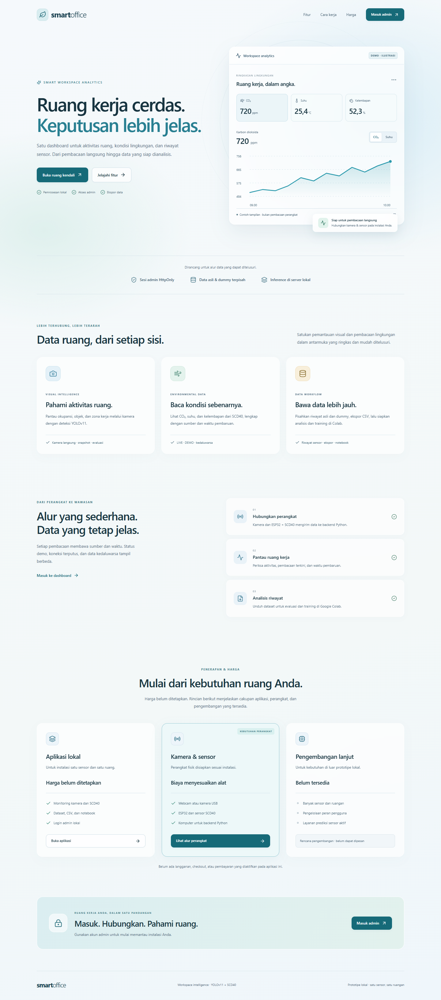
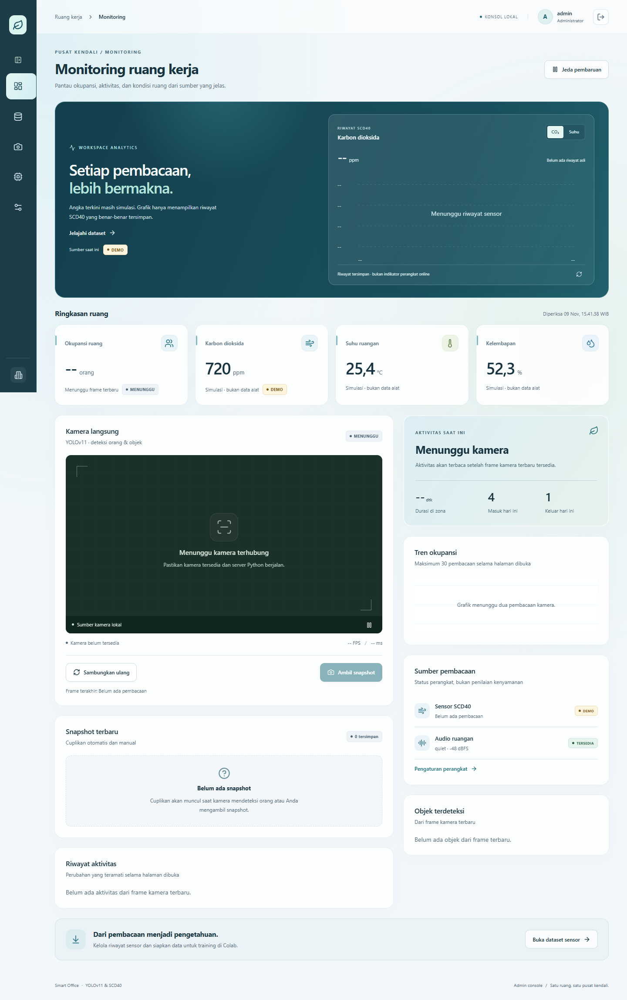

# Smart Office YOLOv11

Dashboard web untuk pemantauan ruang kerja menggunakan Python, Flask, OpenCV, dan YOLOv11. Aplikasi menampilkan video kamera langsung, deteksi penghuni dan objek meja, status aktivitas, serta pencatatan data untuk evaluasi. Sensor SCD40 melalui ESP32 dapat mengirim data kualitas udara ke server.

Frontend tersedia di `apps/web`: **Next.js App Router + React + TypeScript**, dengan login admin serta lima halaman Monitoring, Dataset sensor, Dataset kamera, Model, dan Pengaturan. Flask mengelola perangkat, inference, SQLite, sesi admin dan seluruh API. Dashboard HTML Flask lama sudah dihapus; port 5000 hanya backend API dan mengarahkan pembukaan root ke login Next.js.

Beranda **http://127.0.0.1:3000/** kini berupa landing page SaaS dengan kartu kaca, hero pratinjau, fitur, alur data, pricing, dan tautan login. Pratinjau publik/login diberi label ilustrasi. Dashboard admin menggunakan grafik riwayat sensor asli. Harga belum ditetapkan dan pembayaran belum diaktifkan; tema yang sama berlaku pada semua halaman.

## Menjalankan frontend baru

Kebutuhan tambahan: Node.js 22.20+ dengan npm. Python tetap memakai dependensi di `requirements.txt`.

Terminal pertama, dari folder `SmartOffice_YOLOv11`:

```powershell
python manage_admin.py
python app.py
```

`manage_admin.py` dijalankan sekali untuk membuat akun admin (atau kembali untuk mereset kata sandi). Isi nama pengguna dan kata sandi minimal 12 karakter. Tidak ada akun/kata sandi bawaan. Windows juga dapat menggunakan `setup_admin.bat`. Data akun dan sesi disimpan terpisah di `instance/admin_auth.db`, yang diabaikan version control. Detail ada di [docs/AUTH.md](docs/AUTH.md).

Terminal kedua, dari folder yang sama:

```powershell
cd apps/web
npm ci
npm run dev
```

Buka **http://127.0.0.1:3000/login** dan masuk dengan akun yang dibuat. Flask berjalan di **http://127.0.0.1:5000**. Request `/api/*`, `/video_feed`, `/snapshots/*`, dan `/training_data/*` diteruskan ke Flask oleh Next.js. Sesi memakai cookie HttpOnly, bukan credential di source browser. Salin `apps/web/.env.example` menjadi `.env.local` untuk mengubah `SMARTOFFICE_API_URL`, kemudian mulai ulang Next.js.

Di Windows, `run_frontend.bat` juga dapat digunakan untuk menjalankan frontend (backend dijalankan terpisah).

Pratinjau UI dari backend fixture pengujian, bukan pengukuran perangkat nyata:





Jika Windows menampilkan **Application Control policy has blocked this file** saat memuat compiler SWC, gunakan `npm run dev:compat`. Jalur opsional ini memakai compiler WebAssembly yang disertakan sebagai dependensi. Mode produksi: `npm run build:compat` lalu `npm start` (atau `npm run build` pada mesin yang mendukung compiler native). Override compiler ini memakai API internal Next.js dan perlu diperiksa kembali saat memperbarui Next.js; gunakan `package-lock.json` yang disediakan.

Ketika Flask mati, halaman login menjelaskan kegagalan koneksi; sesi harus diverifikasi sebelum dashboard dapat dibuka. Pada sesi aktif, polling menampilkan error jika endpoint data gagal. Buka hanya satu halaman kamera aktif pada instalasi lokal; generator kamera Flask masih mengikuti koneksi MJPEG dan belum dipisah menjadi satu worker bersama. Rincian pengujian dan konfigurasi proxy produksi ada di [apps/web/README.md](apps/web/README.md).

## Fitur

- Login/logout admin, sesi 8 jam, proteksi API/unduhan/video, dan sidebar otomatis mengikuti kedekatan kursor (menu tombol pada ponsel).
- Deteksi jumlah orang dan objek menggunakan model YOLO.
- Tampilan video kamera langsung, status kamera, FPS, dan waktu inferensi.
- Pelacakan aktivitas/zona dan penyimpanan snapshot.
- Pemeriksaan kualitas frame dan penyamaran wajah jika model YuNet tersedia.
- Pemantauan tingkat audio melalui mikrofon (opsional).
- Data CO₂, suhu, dan kelembapan; mode demo digunakan sebelum data SCD40 diterima.
- Ulasan sampel deteksi/audio dan ekspor data untuk analisis atau pelatihan di Google Colab.
- Penyimpanan riwayat menggunakan SQLite.

## Kebutuhan

- Windows 10/11 (petunjuk di bawah memakai Windows) atau lingkungan Python yang kompatibel.
- Python 3.10 atau versi yang didukung oleh paket Ultralytics yang terpasang.
- Kamera USB/webcam untuk deteksi langsung.
- Mikrofon untuk fitur audio (opsional).
- ESP32 dan sensor SCD40 untuk pembacaan CO₂, suhu, dan kelembapan aktual (opsional).
- Koneksi internet saat instalasi dependensi dan pengunduhan bobot model pertama kali, jika bobot belum tersedia.

## Menjalankan di Windows

1. Pasang Python dan pastikan perintah `python` serta `pip` tersedia di terminal.
2. Buka folder proyek ini.
3. Jalankan `setup_admin.bat` sekali, lalu `run_windows.bat` untuk backend.
4. Jalankan `run_frontend.bat` pada terminal lain, lalu buka [halaman login](http://127.0.0.1:3000/login).

Alternatif melalui PowerShell:

```powershell
python -m venv .venv
.\.venv\Scripts\Activate.ps1
python -m pip install --upgrade pip
pip install -r requirements.txt
python app.py
```

Kamera harus dapat diakses oleh komputer yang menjalankan Flask. Tutup aplikasi lain yang sedang memakai kamera jika kamera tidak terdeteksi. Model bawaan adalah `yolo11n.pt`; model hasil training `best_smartoffice.pt` dapat dipilih dengan variabel lingkungan `SMARTOFFICE_MODEL` sebelum menjalankan aplikasi.

## Menghubungkan ESP32 + SCD40 (opsional)

1. Pastikan ESP32, komputer server, dan Wi-Fi berada pada jaringan yang sama.
2. Buka `SCD40_ESP32.ino` di Arduino IDE. Pasang library **Sensirion I2C SCD4x** melalui Library Manager.
3. Isi `WIFI_SSID` dan `WIFI_PASSWORD`.
4. Ganti alamat IP pada `API_URL` dengan IP komputer yang menjalankan Flask, misalnya `http://192.168.1.10:5000/api/scd40`. Jangan gunakan `127.0.0.1` pada ESP32 karena alamat itu menunjuk ke ESP32 sendiri.
5. Unggah program ke ESP32. Saat data diterima, status sensor di dashboard berubah dari mode demo ke data SCD40.

## Struktur utama

```text
SmartOffice_YOLOv11/
├── app.py                         # Server Flask, deteksi, API, dan database
├── apps/web/                      # Antarmuka Next.js dan login admin
├── admin_auth.py                  # Akun, sesi dan perlindungan API
├── manage_admin.py                # Pembuatan/reset akun lokal
├── instance/admin_auth.db         # Hash akun dan sesi lokal (tidak dikomit)
├── requirements.txt               # Dependensi Python
├── run_windows.bat                # Instalasi dan peluncuran di Windows
├── best_smartoffice.pt            # Bobot YOLO hasil training khusus (opsional)
├── yolo11n.pt                     # Bobot model bawaan/fallback
├── face_detection_yunet_2023mar.onnx # Model deteksi wajah untuk blur privasi
├── SCD40_ESP32.ino                # Contoh firmware ESP32 + sensor SCD40
├── smartoffice.db                 # Database SQLite
├── snapshots/                     # Snapshot kamera
├── training_data/                 # Sampel untuk evaluasi/ekspor
└── dataset_images/                # Gambar dataset hasil pengambilan
```

Folder `snapshots/`, `training_data/`, dan `dataset_images/` dibuat otomatis bila belum tersedia. Database `smartoffice.db` juga diinisialisasi saat aplikasi berjalan.

## Data dan privasi

Aplikasi menyimpan sampel evaluasi, titik pelacakan, peristiwa kualitas frame, sampel audio, kunjungan zona, dan pembacaan SCD40 ke SQLite serta menyimpan gambar pada folder proyek. Tombol penghapusan lama mencakup data kamera/audio; riwayat sensor di `sensor_readings` tidak ikut dihapus. Ekspor dan cadangkan data sensor sebelum melakukan pengelolaan database. Pastikan kamera, mikrofon, dan data ruang kerja digunakan sesuai kebijakan privasi organisasi.

## Dataset sensor dan training Colab

1. Jalankan ulang `python app.py` setelah pembaruan ini. Tabel `sensor_readings` dibuat otomatis tanpa menghapus tabel lama.
2. Setelah login, buka [Dataset sensor](http://127.0.0.1:3000/datasets/sensors). Setiap pembacaan valid baru dari `/api/scd40` dicatat otomatis. Riwayat sebelum pembaruan tidak dapat dipulihkan dari nilai terakhir.
3. Pilih **Unduh CSV asli** untuk data yang terkumpul. Data demo dashboard tidak disimpan sebagai data asli. Instalasi saat ini ditujukan untuk satu sensor di satu ruangan.
4. Untuk latihan tanpa alat, gunakan [CSV dummy](sensor_training/scd40_dummy.csv): 30 hari, interval satu menit, 43.200 baris dengan `source=synthetic`.
5. Unggah [notebook SCD40](SmartOffice_Colab_Training_SCD40.ipynb) ke Google Colab. Runtime CPU cukup. Default `DATA_MODE='dummy'` membuat data simulasi sendiri. Pilih `DATA_MODE='upload'` untuk CSV asli atau CSV dummy yang diunduh.
6. Jalankan semua sel. Notebook memprediksi suhu dan CO₂ lima menit ke depan, membandingkan persistence/Ridge/HistGradientBoosting dengan pemisahan waktu, lalu mengunduh ZIP model, metadata, metrik dan grafik.

Hasil dummy hanya latihan alur, bukan akurasi fisik SCD40 atau validasi ruangan nyata. MAE suhu memakai °C dan MAE CO₂ memakai ppm. Model hasil notebook **belum dihubungkan** ke dashboard dan tidak menggantikan bobot YOLO. Contoh hasil simulasi lokal tersedia di `sensor_training/hasil_training_scd40.zip`.

File fitur sensor: `sensor_dataset.py`, `apps/web/src/features/sensors/sensor-dataset.tsx`, dan `tests/test_sensor_dataset.py`. Kontrak data dijelaskan di [SENSOR_API.md](docs/SENSOR_API.md).

## Pengujian fitur sensor

```powershell
python -m unittest discover -s tests -v
```

Tes memakai SQLite sementara dan tidak membuka kamera, memuat YOLO, atau mengubah database pengguna. Notebook juga dapat dijalankan di Colab untuk memeriksa training menyeluruh; dependensi training dipasang oleh sel pertama, terpisah dari dependensi web.

## Rancangan migrasi web

Tahap frontend **Next.js (React + TypeScript)** sudah diimplementasikan di `apps/web` dengan backend Flask. Backend belum dipindahkan ke FastAPI, database/perangkat tetap pada Python, dan model prediksi sensor belum dihubungkan. Dashboard Flask lama telah dihapus.

- [Arsitektur dan struktur folder](docs/ARCHITECTURE.md): tahapan migrasi dan struktur README yang disarankan.
- [Aturan pengembangan](docs/RULES.md): data, model, kode, dan pengujian.
- [Desain halaman](docs/DESIGN.md): navigasi, komponen, palet, serta status data.

## Catatan

- Jika `sounddevice` atau perangkat input audio tidak tersedia, fitur mikrofon akan nonaktif; fungsi dashboard lainnya tetap dapat digunakan.
- Data lingkungan memakai nilai demo sampai server menerima POST dari ESP32 pada endpoint `/api/scd40`.
- Proyek ini menyediakan notebook `SmartOffice_Colab_Training_YOLOv11.ipynb` dan `SmartOffice_Colab_Analisis.ipynb` untuk alur pelatihan/analisis.
- Informasi lisensi komponen pihak ketiga tersedia di `THIRD_PARTY_NOTICES.txt`.
